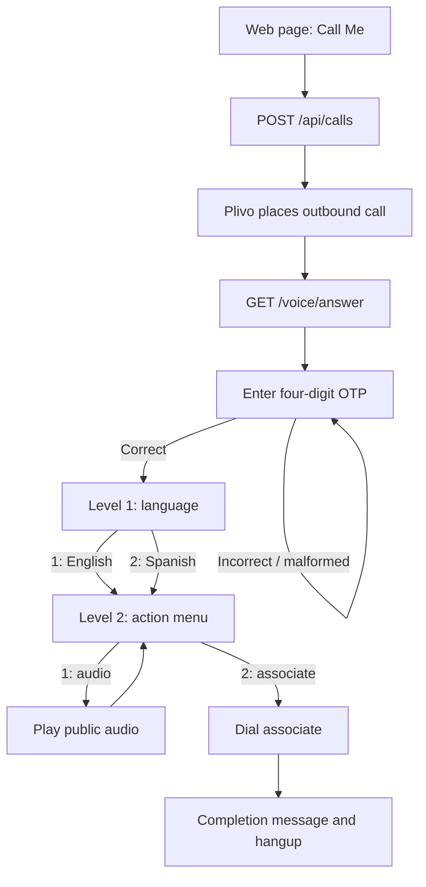

# InspireWorks IVR — Plivo Voice API Demo

A small Flask application demonstrating outbound calling, four-digit DTMF OTP verification, a two-level English/Spanish IVR, audio playback, and transfer to a live associate using the Plivo Voice API.

> **Assignment/demo project, not production telephony software.** The app is intentionally limited to one allow-listed destination. It uses in-memory call sessions and a birthdate-format OTP to match the assignment requirements. Read [Security and limitations](#security-and-limitations) before exposing it to the internet.

## Features

- Trigger a Plivo outbound call from a minimal web page.
- Restrict outbound calls to one configured E.164 destination and require a call-trigger PIN.
- Prompt for a four-digit OTP using DTMF, without logging the entered digits.
- Retry incorrect OTPs until a correct value is entered.
- Offer English or Spanish prompts after successful authentication.
- Play public audio and return to the second-level menu.
- Dial a configured live associate and handle the post-dial result.
- Recover from invalid menu input and repeated silence with a bounded number of retries.
- Provide a health endpoint that reports missing configuration names without returning secret values.
- Test application behaviour with Flask's test client and a mocked Plivo client; automated tests do not place real calls.

## Call flow



## Requirements

- Python 3.10 or newer.
- A Plivo account and an active Plivo number permitted to place outbound voice calls.
- A phone number you control, in E.164 format, to receive the demo call.
- A publicly reachable HTTPS URL for Plivo webhooks. [ngrok](https://ngrok.com/) is convenient during local development.
- Optional: publicly accessible HTTPS MP3s for English and Spanish audio.

## Quick start on macOS

Run these commands from the project directory.

```bash
# 1. Create and activate a virtual environment
python3 -m venv .venv
source .venv/bin/activate

# 2. Install dependencies
python -m pip install --upgrade pip
python -m pip install -r requirements.txt

# 3. Create local configuration
cp .env.example .env
open -e .env
```

Fill in the configuration described below, save `.env`, and start the application:

```bash
python app.py
```

The local app listens on `http://127.0.0.1:5000`. In a second terminal, start the HTTPS tunnel:

```bash
ngrok http 5000
```

Copy ngrok's HTTPS forwarding URL into `PLIVO_PUBLIC_BASE_URL` in `.env`, then restart Flask so it loads the changed value. Keep both the Flask and ngrok processes running during a live call. A URL such as `http://127.0.0.1:5000` cannot be fetched by Plivo's servers.

Verify the public webhook configuration before initiating a call:

```bash
curl https://YOUR-NGROK-HOST/health
```

Expected when all required values are present:

```json
{"status":"ok","configured":true,"missing_configuration":[]}
```

The health endpoint confirms required fields are present; it does **not** validate the credentials with Plivo or guarantee calls will connect.

## Configuration reference

Copy `.env.example` to `.env`. Do not commit `.env` or share its values in screenshots, recordings, issue reports, or chat.

| Variable | Required | Description |
|---|---|---|
| `PLIVO_AUTH_ID` | Yes | Plivo account Auth ID. |
| `PLIVO_AUTH_TOKEN` | Yes | Plivo Auth Token. Keep it secret; rotate any token that has been exposed. |
| `PLIVO_FROM_NUMBER` | Yes | Your provisioned Plivo caller ID in E.164 format, such as `+91…`. |
| `ALLOWED_DESTINATION_NUMBER` | Yes | The single phone number this demo is permitted to call. Must match the form input exactly after trimming. |
| `CALL_TRIGGER_PIN` | Yes | Private PIN required by the Call Me page. Choose a new private value. |
| `PLIVO_PUBLIC_BASE_URL` | Yes | Public HTTPS origin used for callbacks, without a path suffix or trailing slash. |
| `OTP_CODE` | Yes | Four ASCII digits representing the demo birthdate in `DDMM` format; keep it as a string so leading zeros are preserved. |
| `ASSOCIATE_NUMBER` | Yes | Live associate's number in E.164 format. |
| `AUDIO_EN_URL` | No | Public HTTPS audio URL for the English playback branch. |
| `AUDIO_ES_URL` | No | Public HTTPS audio URL for the Spanish playback branch. |

The assignment lists associate number `02264236412`; its international-format representation is `+912264236412`. Confirm the destination is intended and reachable before enabling the transfer branch. Audio variables can be left blank to use the documented sample audio configured in the app.

## Run and test

```bash
# Run the application
python app.py

# Run all automated tests (uses a mock Plivo client; no calls are placed)
python -m pytest -q
```

The automated suite covers input/configuration validation, mocked outbound-call initiation, OTP branches, authentication gating, menu selection, playback/dial XML, call-session isolation, and selected timeout/failure paths. It cannot prove that an external Plivo account, mobile carrier, audio host, ngrok tunnel, or associate phone works in real conditions. Use the manual checks in [docs/testing.md](docs/testing.md) for live verification.

## HTTP endpoints

| Endpoint | Method | Purpose |
|---|---|---|
| `/` | GET | Call-trigger page. |
| `/health` | GET | Configuration status, without secret values. |
| `/api/calls` | POST | Validates the PIN and allow-listed destination, then requests a Plivo call. |
| `/voice/answer` | GET/POST | Starts an isolated call session and asks for the OTP. |
| `/voice/otp` | POST | Validates the four-digit OTP. |
| `/voice/otp-timeout` | POST | Retries after silence; ends after repeated timeout events. |
| `/voice/language` | POST | Accepts English (`1`) or Spanish (`2`) after authentication. |
| `/voice/language-timeout` | POST | Retries a silent language menu, then ends the call. |
| `/voice/menu` | GET/POST | Returns the Level 2 action menu after authentication and language selection. |
| `/voice/action` | POST | Plays audio (`1`) or dials the associate (`2`). |
| `/voice/action-timeout` | POST | Retries a silent Level 2 menu, then ends the call. |
| `/voice/dial-complete` | POST | Handles Plivo's dial result and returns a localized completion/fallback message. |

Webhook routes respond with Plivo XML. The active call is identified by Plivo's `CallUUID` and tracked in a process-local dictionary.

## Project structure

```text
.
├── app.py                    # Flask routes, request validation, call/session flow
├── voice_xml.py              # Plivo XML response builders
├── templates/
│   └── index.html            # Small Call Me web UI
├── tests/
│   ├── test_app.py           # Route and call-flow tests
│   └── test_voice_xml.py     # XML structure tests
├── docs/
│   ├── architecture.md       # Components, flow, session model, design decisions
│   ├── testing.md            # Automated coverage and manual test matrix
│   └── demo-script.md        # Suggested 3–5 minute walkthrough
├── .github/workflows/tests.yml
├── .env.example              # Safe configuration template; no real secrets
├── .gitignore
├── requirements.txt
└── README.md
```

## Troubleshooting

- **`configured: false`:** check that each required key in `.env` is filled in. Do not paste the file into an issue or chat; `/health` lists only missing key names.
- **Plivo cannot fetch the webhook:** confirm the HTTPS URL in `.env` matches the current ngrok forwarding URL and restart Flask after changing it.
- **Call request is rejected:** check credentials, account balance/permissions, caller ID, destination allowlist, and that the destination is in E.164 format. A `202` response means Plivo accepted the request, not that the recipient answered.
- **Associate option says it is not configured:** ensure `ASSOCIATE_NUMBER` is populated in E.164 format and restart Flask.
- **Audio does not play:** check that the selected URL is public HTTPS and that the media host allows Plivo to fetch the file. Try configuring your own MP3 URL.
- **`Address already in use`:** stop the other Flask process with `Control+C` in its terminal, then restart one instance.
- **Tunnel URL changed:** update `PLIVO_PUBLIC_BASE_URL` and restart Flask; a free temporary tunnel URL may change between sessions.

## Security and limitations

This repository is for a controlled assignment demonstration, not production use.

- The OTP is a hardcoded birthdate-formatted demo code. A date of birth is not a strong authentication factor.
- Sessions are stored in memory, expire after one hour, and are not shared across worker processes. Restarting the app clears them; multi-worker deployments can break call-state continuity.
- Outbound calling is restricted to one configured destination and gated by a PIN, but this is not a substitute for a production authentication system, rate limiting, or abuse monitoring.
- The project does not implement full Plivo webhook signature verification. Do not expose these webhook routes as a production service without authenticating provider callbacks.
- Use HTTPS for public callbacks and keep `.env` out of version control.
- OTP DTMF collection is configured not to log keypad input, and application code does not log submitted OTP digits.
- The Flask development server and an ngrok tunnel are for local demonstrations only. Use an appropriately secured deployment for a real service.
- Verify you are allowed to publish this assignment publicly before making the repository public.

See [SECURITY.md](SECURITY.md) for reporting and credential handling guidance.

## Publishing to GitHub

Use [docs/publishing.md](docs/publishing.md) for a safe create-and-push workflow with GitHub CLI, including a final check that `.env` is not staged.

## Suggested demo

Follow [docs/demo-script.md](docs/demo-script.md) for a concise, repeatable walkthrough. Do not show `.env`, credentials, private PINs, real phone numbers, or account pages in the recording.

## References

- [Plivo Voice API: Calls](https://www.plivo.com/docs/voice/api/calls)
- [Plivo Voice XML overview](https://www.plivo.com/docs/voice/xml/overview)
- [Plivo XML input collection](https://www.plivo.com/docs/voice/xml/input)
- [Plivo Python SDK](https://github.com/plivo/plivo-python)
- [ngrok documentation](https://ngrok.com/docs)

## License

MIT; see [LICENSE](LICENSE). Check any assignment-specific publication restrictions before publishing the repository.
